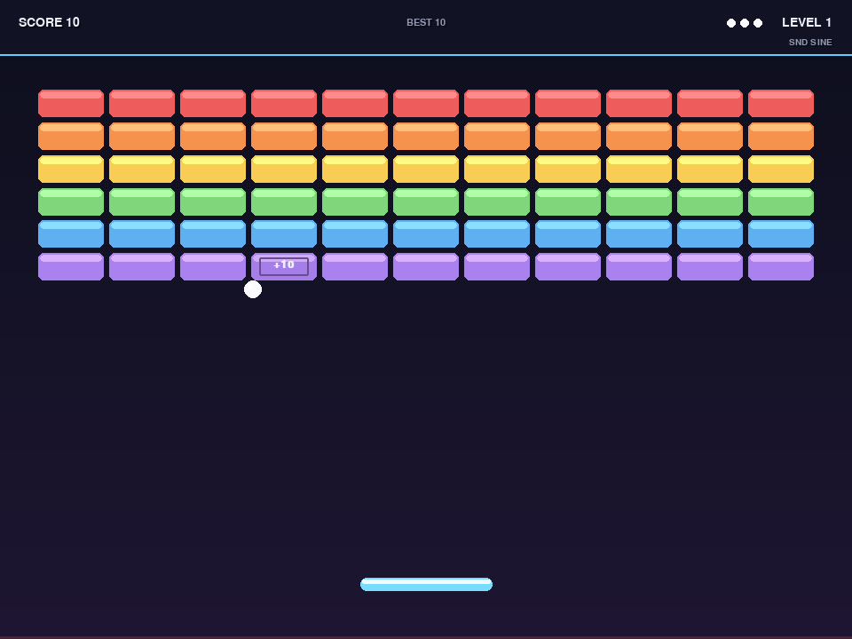
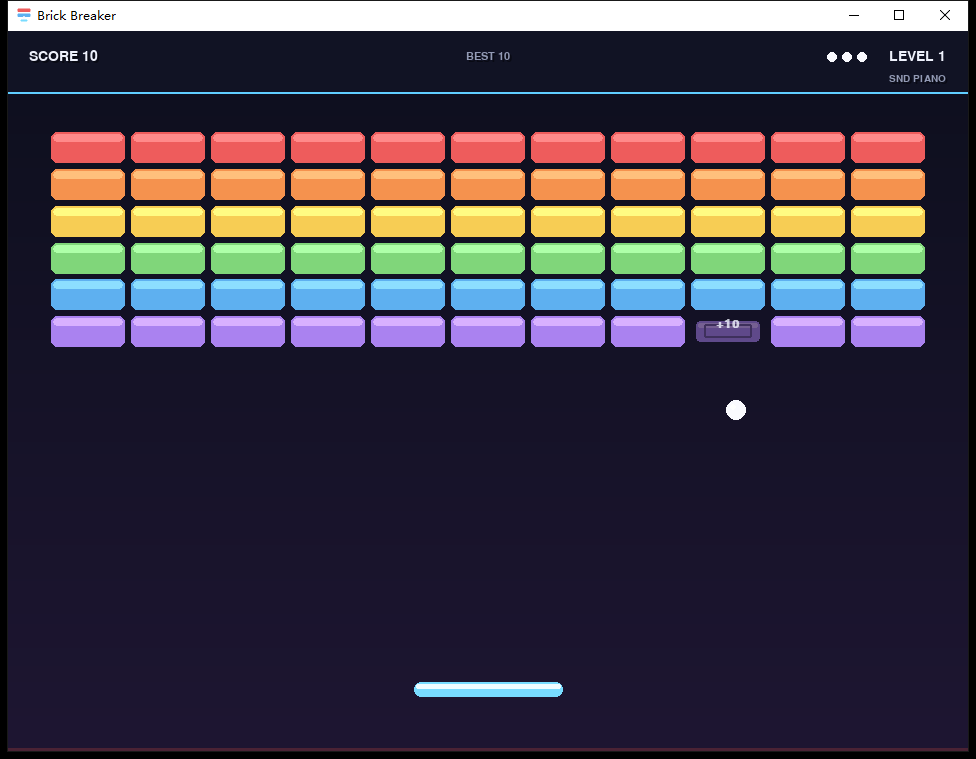

# Brick Breaker

[English](README.md) | [中文](README.zh-CN.md)

A complete brick breaker game written in a single Python file with Pygame. The
same source runs on Windows 10/11 and Linux, including WSL with WSLg. A
self-contained Windows executable is included for machines without Python.



## Features

- **Single-file game** — `bb_v1/brick_breaker.py`; no external images, fonts, or audio files.
- **Cross-platform** — pure Pygame and the Python standard library, with no OS-specific APIs.
- **Fixed 120 Hz physics** — collision sub-stepping keeps behaviour consistent on 60 Hz and 144 Hz displays and prevents the ball from tunnelling through bricks.
- **Paddle english** — the bounce angle depends on both the hit offset and the paddle's instantaneous velocity.
- **Brick state machine** — `INTACT → CRACKED → FADING → GONE`; a destroyed brick stops colliding immediately and fades out, so it cannot be scored twice.
- **Combo scoring** — a multiplier up to ×5, row-based brick values, clear bonuses, and a per-level speed ramp.
- **Procedural audio with selectable timbres** — all cues are synthesised from a
  harmonic-spectrum engine, and `T` cycles four instruments: the original SINE
  voice, PIANO, CLASSICAL (nylon-string) and ACOUSTIC (steel-string) guitar. Every
  preset shares the same note table, so pitches and rhythm never change; no audio
  files are shipped, and the game degrades to silence without an audio device.
- **Resizable and fullscreen** — geometry is derived from the current window size, and losing focus pauses the game automatically.
- **Windows release** — `windows_release/BrickBreaker.exe` bundles Python and pygame, so no installation is required.
- **Tested** — 17 headless `unittest` tests and GitHub Actions CI on Ubuntu and
  Windows (Python 3.10 and 3.12).
- **MIT licensed** — see [`LICENSE`](LICENSE).

## Quick start

### Windows (prebuilt, 64-bit, no Python required)

1. Clone or download this repository.
2. Open `windows_release/`.
3. Double-click **`BrickBreaker.exe`**.

`启动游戏.bat` in the same folder is an optional launcher. When the runtime has
already been unpacked it starts the cached game directly (fast, and it bypasses
the self-extractor); otherwise it starts the exe, and as a last resort it runs
the source version if Python is available.

On the first launch, the exe unpacks its private runtime to
`%LOCALAPPDATA%\BrickBreaker` (about 33 MB) and then starts the game. Later
launches use that cache and start immediately. No administrator rights are
needed.



The exe has no single-instance guard: double-clicking it twice starts two
independent game windows. Close the extra one with `Q` or `Esc`.

### From source

Requirements:

- Python 3.10+ for `pygame-ce` 2.5.x (the game code itself targets Python 3.8+;
  Python 3.8/3.9 users can use the classic `pygame` 2.x package)
- Pygame 2.x

```bash
python -m pip install pygame-ce
python bb_v1/brick_breaker.py
```

On Linux, use `python3` if that is how Python is installed:

```bash
python3 -m pip install pygame-ce
python3 bb_v1/brick_breaker.py
```

For WSL, run the game from a WSLg-enabled terminal (Windows 11 WSL, or Windows 10
with WSLg installed). A headless server can use `SDL_VIDEODRIVER=dummy` for
smoke tests, but that is not a playable display.

## Controls

| Key | Action |
| --- | --- |
| `←` / `→` or `A` / `D` | Move the paddle |
| `Space`, `↑`, or `Enter` | Launch the ball |
| `P` | Pause / resume |
| `R` | Restart the run |
| `M` | Mute / unmute |
| `T` | Cycle instrument sound (SINE → PIANO → CLASSICAL → ACOUSTIC) |
| `F` | Toggle fullscreen |
| `Q` or `Esc` | Quit |
| `R` / `Q` on game over | Restart / quit |

## Sound

All audio is synthesised at run time — the repository ships no sound files. The
same set of cues is rendered from one instrument-independent note table, so the
melody, timing and volume balance never change; `T` only swaps the timbre:

| Preset | HUD label | Character |
| --- | --- | --- |
| `SINE` | `SND SINE` | the original v1.0.0 electronic voice (default) |
| `PIANO` | `SND PIANO` | fast hammer attack, six harmonics, exponential decay |
| `CLASSICAL` | `SND CLASSICAL` | nylon-string guitar: soft attack, warm, fewer high harmonics |
| `ACOUSTIC` | `SND ACOUSTIC` | steel-string guitar: bright pick attack, strong harmonics |

The first switch to a preset synthesises and caches it (~0.1–0.2 s once); later
switches are instant. The selection is process-local (not written to disk), like
the best score. If no audio device is available the game keeps running silently
and still cycles the HUD label.

## Rules and scoring

- Start with **3 lives**. Losing the ball costs one life; at zero lives the run ends.
- The wall has 11 columns and 6–8 rows, depending on the level.
- Bricks in higher rows are worth more points.
- From level 3 onward, the top row has 2 hit points and is worth double points.
- Every 4 destroyed bricks increases the combo multiplier, up to **×5**.
- Clearing a level awards **250 × level** bonus points.
- Ball speed grows by about 7% per level, capped at 2.4× the base speed.
- Each paddle hit adds a small rally speed boost, capped at 1.75×.
- Destroyed bricks fade for 0.30 s and cannot be hit again during the fade.

The best score and best combo are tracked for the current process only; they are
not persisted to disk.

## Project layout

```text
.
├── .gitattributes              # line-ending and binary-file policy
├── .github/
│   └── workflows/
│       ├── ci.yml              # headless tests: Ubuntu + Windows, Python 3.10/3.12
│       └── release.yml         # tag-driven Windows build and GitHub Release
├── .gitignore
├── LICENSE                     # MIT
├── README.md                   # this file (English)
├── README.zh-CN.md             # Chinese README
├── CHANGELOG.md
├── CONTRIBUTING.md
├── docs/
│   └── screenshot-windows.png  # captured from the packaged Windows exe
├── architecture.txt            # original one-paragraph use case
├── bb_v1/
│   ├── brick_breaker.py        # the complete game
│   ├── docs/
│   │   ├── architecture.md     # state diagrams, ERD, module contracts
│   │   └── screenshot.png
│   └── prompts/
│       └── prompt.md           # dated v1 prompt and review notes
├── bb_v2/
│   └── README.md               # reserved for a future rewrite
├── build_win/
│   ├── BrickBreaker.nsi        # NSIS build script for the Windows exe
│   ├── build_windows.ps1       # reproducible local build (pinned, SHA256-verified inputs)
│   ├── README.md               # Windows build documentation
│   ├── make_icon.py            # generates app.ico from the in-game icon
│   ├── app.ico
│   ├── app_icon.png
│   ├── payload/                # generated runtime; launcher.pyw is tracked
│   ├── downloads/              # downloaded build inputs (local only)
│   └── nsis/                   # NSIS toolchain (local only)
├── tests/
│   ├── test_brick_breaker.py   # headless unittest suite
│   └── README.md
└── windows_release/
    ├── BrickBreaker.exe
    └── 启动游戏.bat
```

`build_win/downloads/`, `build_win/nsis/`, `build_win/payload/python/`, and the
copied `build_win/payload/app/brick_breaker.py` are local build inputs or
generated output. They are excluded by `.gitignore`; only the small
`build_win/payload/app/launcher.pyw` build wrapper is tracked.

## Architecture

The implementation is split into 11 modules, each marked in the source with a
`# === M<n> ... ===` banner:

| Module | Responsibility |
| --- | --- |
| M1 `CONFIG` | Tunables, palette, enums, fixed-timestep constants |
| M2 `GEOMETRY` | The playfield room, brick grid, and derived sizes |
| M3 `MODEL` | Entities: `Brick`, `Paddle`, `Ball`, `RunStats`, `Record`, `Settings` |
| M4 `PHYSICS` | Collision detection/response and collision events |
| M5 `RULES` | Pure scoring, combo, bonus, and speed policy |
| M6 `LEVELS` | Level profiles and brick-wall construction |
| M7 `AUDIO` | Procedural sound effects with silent fallback |
| M8 `VIEW` | Read-only renderer for the playfield, HUD, and overlays |
| M9 `INPUT` | SDL events to `Intent` values and paddle axis |
| M10 `SESSION` | Run state machine and the single owner of `RunState` |
| M11 `APP` | Window creation, event dispatch, and the main loop |

The full architecture document, including the session/ball/brick state machines,
ERD, module dependency graph, invariants, and requirement traceability matrix, is
in [`bb_v1/docs/architecture.md`](bb_v1/docs/architecture.md).

Key design rules:

- Physics is advanced at 120 Hz with bounded sub-steps; rendering is decoupled from simulation.
- `CollisionEngine` reports facts and does not score, play audio, or draw.
- `ScoringRules` is stateless; `Renderer` never mutates the session.
- `GameSession` is the only place that assigns `RunState`.

## Tests

The repository ships a headless `unittest` suite (standard library only, no
pytest) for the single-file game:

```bash
python -m pip install "pygame-ce==2.5.8"
python -m unittest discover -s tests -v
```

The tests force SDL's dummy video/audio drivers before pygame is imported, so
they run without a display or a sound card — locally, on a server, and in CI.
They cover configuration and geometry, `App`/`Renderer` construction and
drawing, ball launch movement, combo/scoring rules, the brick damage state
machine, the game-over transition, and the audio subsystem (note table and
preset data, the bit-identical SINE voice, distinct bounded PCM for every
acoustic preset, lazy instrument switching, no-mixer degradation, and the
`T`-key intent path). See [`tests/README.md`](tests/README.md) for the details.

Maintainer checkouts that already contain the generated Windows payload can run
the same suite without installing anything:

```powershell
build_win\payload\python\python.exe -m unittest discover -s tests -v
```

The same command runs in
[`.github/workflows/ci.yml`](.github/workflows/ci.yml) on Ubuntu and Windows with
Python 3.10 and 3.12; the current status is on the repository's **Actions** tab.

## Windows build

The included `BrickBreaker.exe` is a single-file NSIS self-extractor containing:

- Windows embeddable Python 3.12.10
- pygame-ce 2.5.8 (`cp312-win_amd64`)
- `brick_breaker.py` and a small `launcher.pyw` that reports startup errors

The build script is [`build_win/BrickBreaker.nsi`](build_win/BrickBreaker.nsi).
It targets 64-bit Windows and writes `windows_release/BrickBreaker.exe`.

The binary committed under `windows_release/` is built from this source. After
changing `bb_v1/brick_breaker.py` (for example when adding instrument presets),
rebuild it with the script below — or let the release workflow rebuild it for a
tagged release — otherwise the exe keeps shipping the previous game code.

### Rebuild it locally

[`build_win/build_windows.ps1`](build_win/build_windows.ps1) reproduces the
bundled executable from pinned inputs (Python 3.12.10 embeddable zip and the
pygame-ce 2.5.8 wheel, both SHA256-verified):

```powershell
pwsh -File build_win\build_windows.ps1
```

It downloads the build inputs into `build_win\downloads\` only when they are
missing, expands the runtime into `build_win\payload\`, patches
`python312._pth`, installs pygame-ce into the payload, copies the game source,
runs NSIS, and prints the output path, size, and SHA256. Use `-Clean` to rebuild
the payload from scratch, and see [`build_win/README.md`](build_win/README.md)
for the layout, pinned versions, and URLs. NSIS 3.x (`makensis.exe`) is required.

The current payload can also be packaged manually:

```bash
cd build_win
makensis BrickBreaker.nsi
```

### Automated release build

Pushing a `v*` tag (for example `v1.1.0`) runs
[`.github/workflows/release.yml`](.github/workflows/release.yml) on a
GitHub-hosted Windows runner. It rebuilds the exe with the same pinned inputs,
runs the test suite first, uploads the executable as a workflow artifact, and
publishes a GitHub Release containing `BrickBreaker.exe`, a
`BrickBreaker-<tag>-windows-x64.zip` package (exe + launcher batch file +
`README.txt`), and `SHA256SUMS.txt`. The workflow can also be started manually
with `workflow_dispatch` to produce the build artifact without creating a
release.

Behaviour:

- First run extracts to `%LOCALAPPDATA%\BrickBreaker`.
- Subsequent runs launch from that cache.
- To force a clean unpack, delete `%LOCALAPPDATA%\BrickBreaker` and start the exe again.
- Startup failures show a native message box and write
  `%LOCALAPPDATA%\BrickBreaker\app\startup_error.log`.

The exe is not code-signed. Windows SmartScreen may show a warning; use
**More info → Run anyway** if you trust the build. Some antivirus products may
also flag unsigned self-extracting Python executables.

## Verification and limitations

- The game source is smoke-tested headlessly by the [`tests/`](tests/) suite
  (17 tests): configuration and geometry, `App`/`Renderer` construction and
  drawing, ball launch, scoring rules, the brick damage state machine, the
  game-over transition, and the audio subsystem (note/preset data, the
  bit-identical SINE voice, distinct bounded PCM for every acoustic preset,
  lazy switching, no-mixer degradation and the `T` intent). The suite is wired
  into CI for Ubuntu and Windows with Python 3.10 and 3.12.
- The instrument presets were exercised in a real window with the packaged
  runtime on Windows 10 22H2: `T` cycled `SINE → PIANO → CLASSICAL → ACOUSTIC`,
  the HUD label followed, and shutdown stayed clean (`Esc` in ~0.2 s).
- The Windows payload was verified end-to-end on Windows 10 22H2 (64-bit) by
  installing it into a test directory with the same NSIS script: 196 files
  extracted, the game window appeared, and all four presets, pause, mute and
  fullscreen behaved as expected. Screenshots and audition WAVs are kept in the
  maintainer's local `verification/` folder.
- The committed `windows_release/BrickBreaker.exe` is a v1.1.0 NSIS build. The
  one-off self-extraction step could not be re-run inside the automation
  harness because its process TEMP folder is invalid for NSIS ("Error writing
  temporary file"); the same error occurs with the previous v1.0.0 build, so it
  is an environment artifact, not a build defect. A normal Explorer double-click
  uses the user's valid TEMP. `启动游戏.bat` also skips the self-extractor when
  the runtime cache already exists.
- The exe has no single-instance guard: launching it twice opens two independent
  games.
- The Windows build inputs are pinned and SHA256-verified by both
  `build_win/build_windows.ps1` and the release workflow.
- `bb_v2/` is reserved for a future rewrite and is intentionally empty apart from
  its [`README.md`](bb_v2/README.md).

## Development history

See [`CHANGELOG.md`](CHANGELOG.md) for the maintained changelog. The original v1
prompt and review notes are in
[`bb_v1/prompts/prompt.md`](bb_v1/prompts/prompt.md), dated 2026-09-22.

Known milestones:

- **2026-09-22** — v1: initial single-file Pygame implementation, targeting
  Windows 10/11 and Linux/WSL.
- **2026-10-19** — Windows packaging: embedded Python/pygame runtime, generated
  application icon, NSIS single-file exe, one-click launcher, English README,
  gameplay screenshot, and repository `.gitignore`.
- **2026-10-23** — v1.0.0 repository hardening: MIT license, headless unittest
  suite, GitHub Actions CI and release workflows, reproducible
  `build_win/build_windows.ps1`, Chinese README, CHANGELOG, CONTRIBUTING, and
  the reserved `bb_v2/` placeholder.
- **2026-10-23** — v1.1.0 audio timbres: instrument-independent note table,
  data-driven instrument presets, wavetable synthesis with attack transients,
  lazy per-preset synthesis and caching, `T` key to cycle SINE / PIANO /
  CLASSICAL / ACOUSTIC, HUD label, and 9 new headless audio tests.

## Contributing

Contributions are welcome. Please read [`CONTRIBUTING.md`](CONTRIBUTING.md)
first: the game stays a single file, and changes to `bb_v1/brick_breaker.py`
should be discussed in an issue or pull request before implementation. Run the
test suite before opening a pull request.

## License

Released under the MIT License — see [`LICENSE`](LICENSE).
Copyright (c) 2026 Brick Breaker contributors.

The bundled Python runtime and pygame-ce keep their own upstream licenses
(Python is distributed under the PSF License; pygame-ce under the LGPL-2.1).

