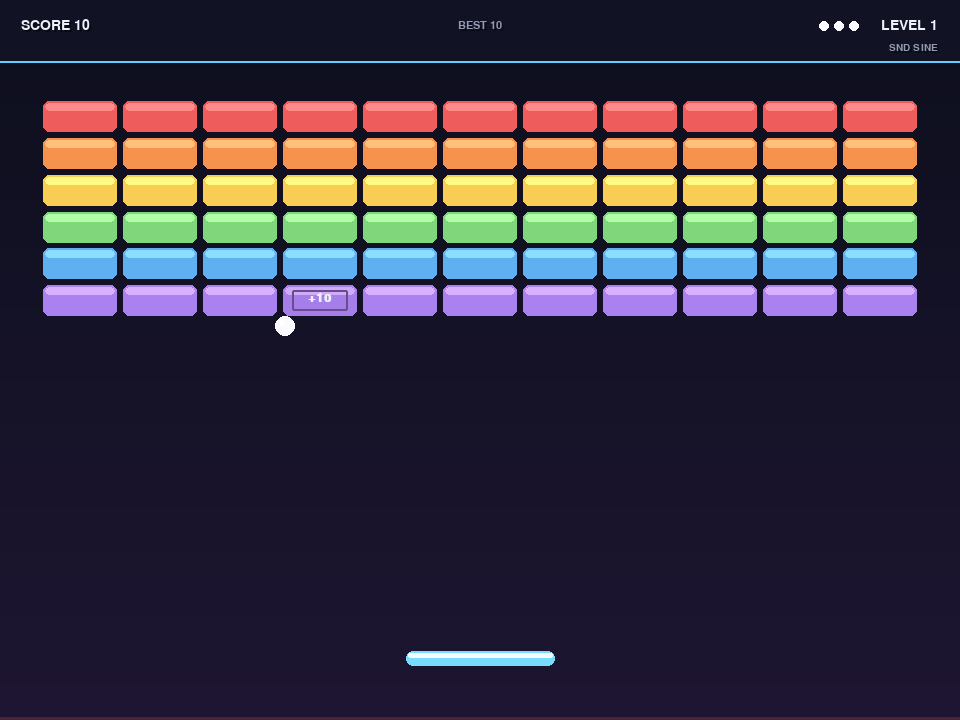
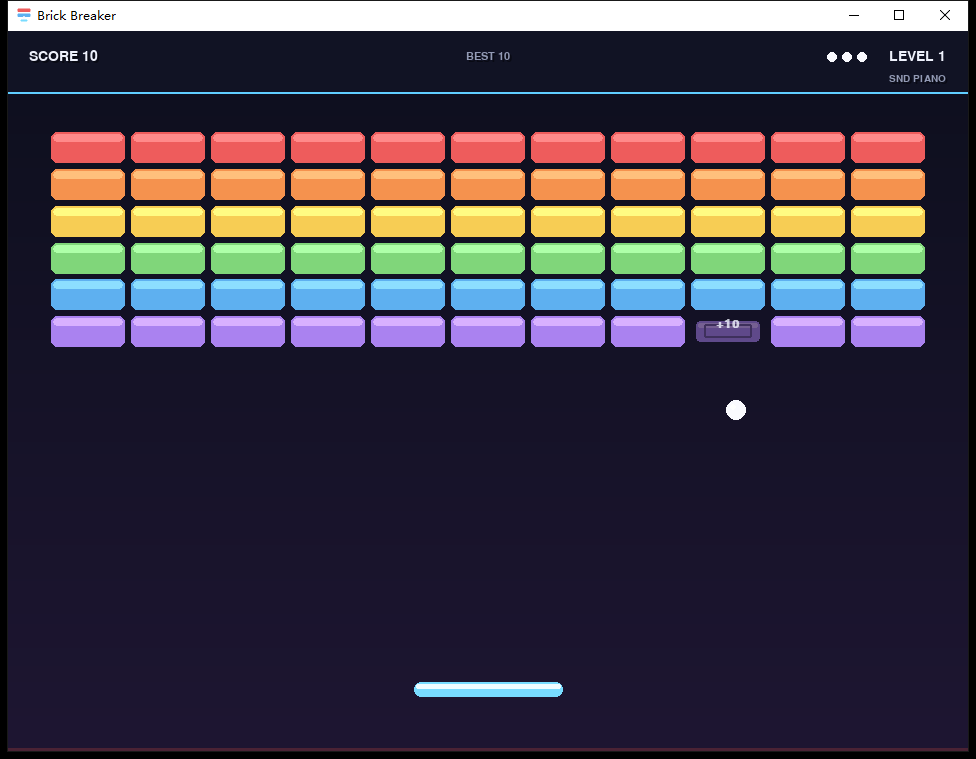

# Brick Breaker（打砖块）

[English](README.md) | 中文

用单个 Python 文件实现的完整弹球（打砖块）游戏，基于 Pygame。同一份源码可在
Windows 10/11 与 Linux（含 WSLg）上运行；仓库同时提供一个自带运行时的 Windows
可执行文件，机器上无需安装 Python。



## 快速开始

### Windows（预编译，64 位，无需 Python）

1. 克隆或下载本仓库。
2. 打开 `windows_release/` 目录。
3. 双击 **`BrickBreaker.exe`**。

同目录的 `启动游戏.bat` 是可选启动器：如果运行环境已经解压过，它会直接启动缓存里的
游戏（更快，也绕过自解压程序）；否则启动 exe；最后才回退到源码 + Python。
首次运行时，exe 会把私有运行环境解包到 `%LOCALAPPDATA%\BrickBreaker`（约 33 MB），
之后启动会直接使用缓存，无需管理员权限。exe 未进行代码签名，Windows SmartScreen
可能提示风险；确认信任后选择 **更多信息 → 仍要运行**。



exe 没有单实例限制：连续双击会打开两个独立的游戏窗口，用 `Q` 或 `Esc`
关掉多余的那个即可。

### 从源码运行

需要 Python 3.10+ 与 Pygame 2.x：

```bash
python -m pip install pygame-ce
python bb_v1/brick_breaker.py
```

Linux 上可能是 `python3`。WSL 请使用支持 WSLg 的终端。

## 操作

| 按键 | 操作 |
| --- | --- |
| `←` / `→` 或 `A` / `D` | 移动挡板 |
| `Space`、`↑` 或 `Enter` | 发射小球 |
| `P` | 暂停 / 继续 |
| `R` | 重新开始 |
| `M` | 静音 / 取消静音 |
| `T` | 切换音色（SINE → 钢琴 → 古典吉他 → 民谣吉他） |
| `F` | 切换全屏 |
| `Q` 或 `Esc` | 退出 |
| 游戏结束后 `R` / `Q` | 重新开始 / 退出 |

## 音效

所有音效都在运行时合成，仓库里没有任何音频文件。16 个音效共用一份与音色无关的
“乐谱”（音高、时长、音量完全相同），`T` 键只切换音色：

| 预设 | HUD 显示 | 音色特点 |
| --- | --- | --- |
| `SINE` | `SND SINE` | v1.0.0 原版电子音（默认） |
| `PIANO` | `SND PIANO` | 钢琴：快速击弦 + 6 个泛音 + 指数衰减 |
| `CLASSICAL` | `SND CLASSICAL` | 古典吉他（尼龙弦）：起音柔和、偏暖、少高次泛音 |
| `ACOUSTIC` | `SND ACOUSTIC` | 民谣吉他（钢弦）：明亮拨弦、泛音更丰富 |

第一次切到某个音色会合成并缓存（约 0.1–0.2 秒，仅一次），之后切换即时生效。
音色选择只在本次进程内有效（和最高分一样不写磁盘）；没有声卡时游戏静音运行，
HUD 仍会显示当前音色。

## 规则与计分

- 初始 **3 条生命**，球落出底部会失去一条，归零则游戏结束。
- 砖墙 11 列、6–8 行（随关卡变化），越靠上的砖块分值越高。
- 第 3 关起，顶部一行砖块有 2 点生命、分值翻倍。
- 每击碎 4 块砖提升一级连击倍率，最高 **×5**。
- 通关奖励 **250 × 关卡数**；球速每关约提升 7%，上限 2.4 倍；挡板每次击球也会小幅加速，上限 1.75 倍。
- 被击碎的砖块渐隐 0.30 秒，期间不再参与碰撞，因此不会被重复计分。

最高分与最高连击仅在当前进程内统计，不会写入磁盘。

## 测试

测试套件仅使用标准库 `unittest`，无需 pytest；它在导入 pygame 前强制使用 SDL
dummy 视频/音频驱动，因此无显示器、无声卡也能运行（共 17 个测试）：

```bash
python -m pip install "pygame-ce==2.5.8"
python -m unittest discover -s tests -v
```

覆盖配置与几何、`App`/`Renderer` 构建与绘制、发球后的移动、连击与计分规则、砖块
生命状态机、游戏结束流程，以及音效子系统（音符表/预设数据、SINE 与原版逐位一致、
各声学音色 PCM 不同且有界、懒合成切换、无声卡降级、`T` 键 Intent 链路）。
详见 [`tests/README.md`](tests/README.md)。CI 配置
（[`.github/workflows/ci.yml`](.github/workflows/ci.yml)）在 Ubuntu 与 Windows、
Python 3.10/3.12 上运行同一套测试。

## Windows 构建

`windows_release/BrickBreaker.exe` 是 NSIS 单文件自解压程序，内置 Windows 嵌入版
Python 3.12.10 与 pygame-ce 2.5.8。重建方式：

```powershell
pwsh -File build_win\build_windows.ps1
```

脚本只在本机缺少构建输入时联网下载，并对固定版本的 Python 嵌入包与 pygame-ce
wheel 做 SHA256 校验；需要安装 NSIS 3.x（`makensis`）。推送 `v*` 标签会触发
GitHub Actions 在 Windows 上自动重新构建并发布 Release（exe + zip 包 +
`SHA256SUMS.txt`）。细节见 [`build_win/README.md`](build_win/README.md) 与
[`.github/workflows/release.yml`](.github/workflows/release.yml)。

## 项目结构

- `bb_v1/brick_breaker.py` — 全部游戏源码（单文件，M1–M11 模块标记）。
- `bb_v1/docs/architecture.md` — 架构、状态图与 ERD。
- `tests/` — 无头测试套件。
- `build_win/` — Windows 打包脚本与固定版本的构建输入。
- `windows_release/` — 预编译 exe 与启动器。
- `.github/workflows/` — CI 与发布流水线。
- `bb_v2/` — 预留给未来重构，目前只有占位说明。

## 许可证

本项目以 [MIT](LICENSE) 许可证发布，版权归 2026 Brick Breaker contributors 所有。
内置的 Python 与 pygame-ce 仍遵循各自的上游许可证。

## English

English documentation: [README.md](README.md).
