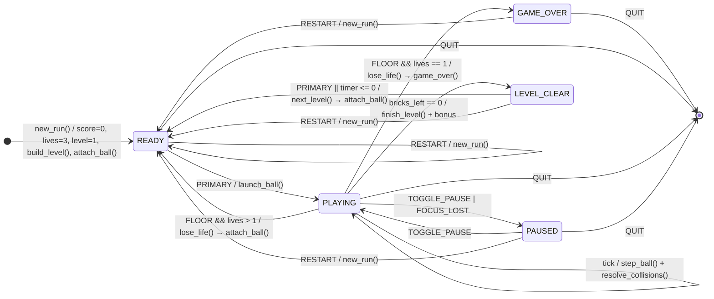
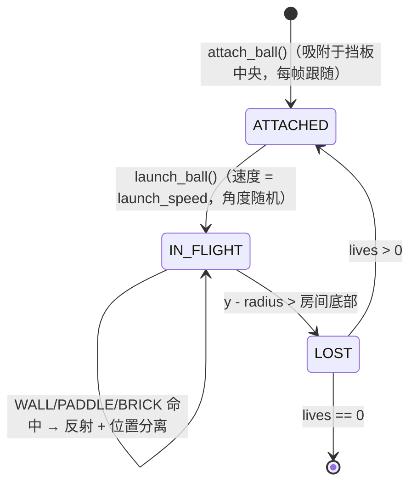
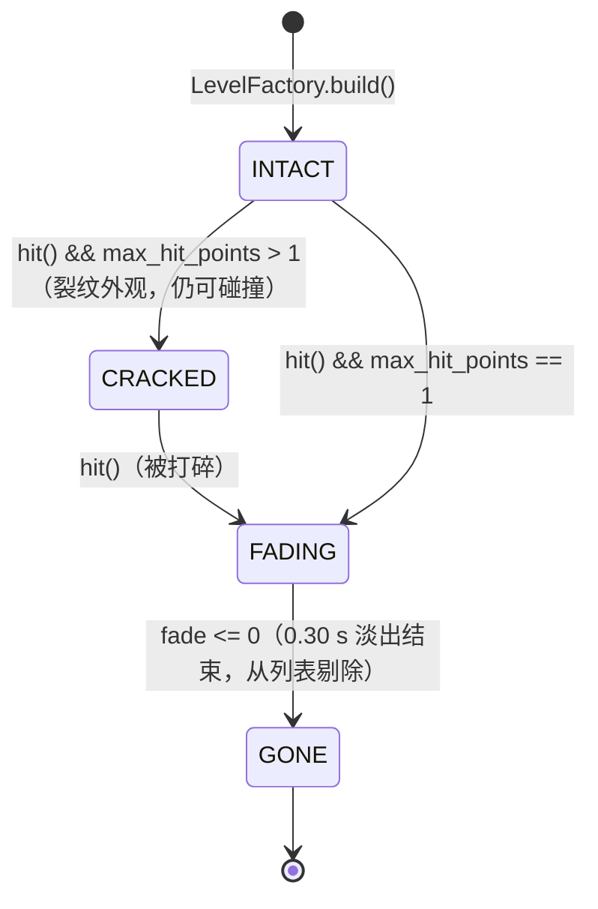
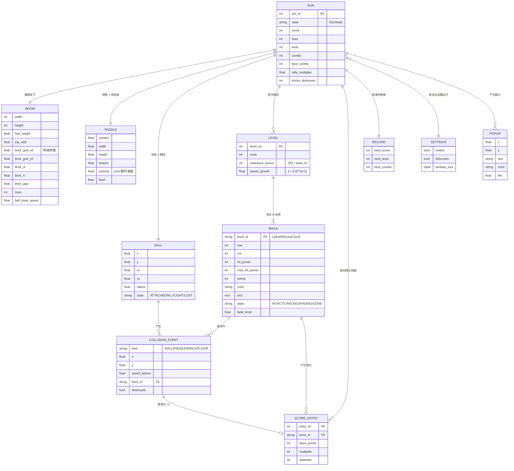
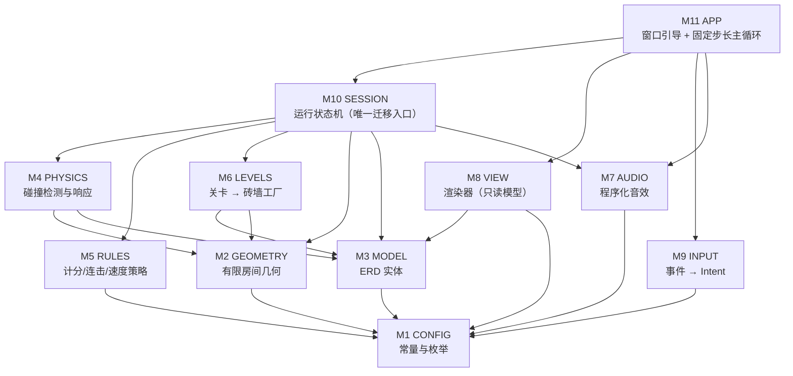

# 弹球游戏（Brick Breaker）系统架构设计

> 版本：v2 · 对应实现：`brick_breaker.py`（单文件，11 个模块 M1–M11）
> 目标平台：Windows 10/11 与 Linux（含 WSL）· 依赖：Python 3.8+ / Pygame 2.x

本文档以 **Use Case** 为输入，给出：① 软件运行完整流；② 状态图（State Diagram）；③ ERD；
④ 由二者推导出的全部系统模块（Module）与它们的职责边界。代码中的每个模块都带有
`# === M<n> <NAME> ===` 分隔标记，与本文模块编号一一对应。

---

## 0. Use Case → 需求编号

| 编号 | Use Case 原文要素 | 系统需求 |
|------|------------------|----------|
| R1 | 球、板、砖块运行在「有限房间」内 | 房间四壁构成边界，球在边界内反弹 |
| R2 | 用户可以移动挡板 | 左右方向键驱动挡板水平移动，且被限制在房间内 |
| R3 | 球初始发射到挡板上 | 球初始 `ATTACHED` 于挡板中央，等待发射 |
| R4 | 球撞挡板后，按**角度 + 挡板瞬时移动**反弹 | 反弹向量 = 命中偏移角 + 挡板瞬时速度产生的 english（旋转） |
| R5 | 球撞墙反弹 | 左右墙/顶墙镜像反射 |
| R6 | 球撞砖块反弹 | 圆-矩形碰撞，沿命中法线反射并做位置分离 |
| R7 | 被击中的砖块「渐隐」 | 砖块进入 `FADING` 状态：立即失去碰撞、视觉淡出后移除 |
| R8 | 球落下未被挡板接住 → 失败 | 失落一次生命；生命耗尽 → `GAME_OVER`，R 重开 / Q 退出 |
| R9 | （扩展）计分与关卡推进 | 命中计分、连击倍率、清关奖励、逐关加速 |

---

## 1. 软件运行完整流

### 1.1 端到端流程（启动 → 退出）

```
 1  启动：python brick_breaker.py
 2  M11 App 初始化：pygame.mixer.pre_init → pygame.init → 估算适配桌面的窗口尺寸
 3  M11 App：创建 RESIZABLE 窗口、图标、Clock
 4  M7  Audio：合成音效（失败则静默降级，不阻塞启动）
 5  M2  Geometry：FieldLayout.compute(w, h, rows) 计算「房间」尺寸、砖块网格、挡板/球尺寸、基础速度
 6  M6  Levels：LevelFactory.build(level=1, layout) 生成砖墙（每块砖 ID/点数/颜色/HP，状态 INTACT）
 7  M10 Session：new_run() → score=0, lives=3, level=1, combo=0, RunState.READY
 8  M10 Session：attach_ball() → 球吸附在挡板中央（BallState.ATTACHED）
 9  M11 App 主循环（固定步长）：
 9a    读取 SDL 事件 → M9 InputController 翻译为 Intent
 9b    App 处理窗口级 Intent（RESIZE / TOGGLE_FULLSCREEN / QUIT）
 9c    Session 处理游戏级 Intent（PRIMARY / TOGGLE_PAUSE / RESTART / TOGGLE_MUTE / FOCUS_LOST）
 9d    以 120 Hz 步长推进 Session.update(dt)（见 1.2）
 9e    M8 Renderer 绘制：背景 → 砖墙（含渐隐）→ 挡板 → 球 → 飘分 → HUD → 浮层
 9f    pygame.display.flip()
10  退出条件：QUIT 事件 / Q / Esc / 关闭窗口 → pygame.quit() → 返回 0
```

### 1.2 单帧流水线（固定步长 120 Hz）

```
frame_time = min(clock.tick(60), MAX_FRAME_TIME)
for event in pygame.event.get():  InputController.handle(event) → Intent 列表
accumulator += frame_time                # 累加真实时间
while accumulator >= PHYSICS_STEP:       # 逻辑步进，与渲染帧率解耦
    Session.update(PHYSICS_STEP)
        ├─ 1. Paddle.move(axis, speed, dt)        # 记录瞬时速度 paddle.velocity（R4 的输入）
        ├─ 2. 依 RunState 分支
        │     READY       : attach_ball()          # 球跟随挡板（R3）
        │     PLAYING     : CollisionEngine.step() → CollisionEvent 列表
        │     LEVEL_CLEAR : 倒计时 → next_level()
        │     PAUSED      : 冻结（仅 GUI 事件可唤醒）
        ├─ 3. 消费 CollisionEvent：WALL→音效；PADDLE→english 反弹 + 加速 + combo 归零；
        │     BRICK→伤害/渐隐/计分（destroyed 时）/清关判定；FLOOR→lose_life()
        ├─ 4. 推进渐隐计时（FADING → GONE）与飘分动画
        └─ 5. 判定状态迁移（LEVEL_CLEAR / READY / GAME_OVER）
    accumulator -= PHYSICS_STEP
Renderer.draw(screen, session)           # 渲染只读模型，不修改任何游戏状态
pygame.display.flip()
```

### 1.3 组件时序（一次击砖 + 一次挡板反弹）

```mermaid
sequenceDiagram
    autonumber
    actor P as 玩家
    participant I as M9 InputController
    participant A as M11 App
    participant S as M10 GameSession
    participant X as M4 CollisionEngine
    participant R as M5 ScoringRules
    participant D as M8 Renderer

    P->>I: 按下 ← / →
    I-->>A: [Intent] + axis
    A->>S: set_move_axis(axis)
    A->>S: update(dt)  (x N 子步)
    S->>S: Paddle.move() 更新 position/velocity
    S->>X: step(ball, paddle, bricks, layout, dt)
    X->>X: 子步推进 + 墙/挡板/砖块检测
    X-->>S: [CollisionEvent(BRICK, id, destroyed=True)]
    S->>R: brick_points(brick, combo+1)
    R-->>S: (multiplier, awarded)
    S->>S: score += awarded; brick.state = FADING; bricks_left -= 1
    Note over S: bricks_left == 0 → RunState.LEVEL_CLEAR
    P->>I: 松开按键
    A->>S: update(dt)
    S->>X: step(...)
    X-->>S: [CollisionEvent(PADDLE, speed)]
    S->>R: next_rally_multiplier() / launch_speed()
    R-->>S: 新的球速
    S->>S: ball.set_magnitude(speed)（方向已由 english 决定）
    A->>D: draw(screen, session)
    D-->>P: 画面（砖块淡出、HUD 计分、连击徽标）
```

### 1.4 关键场景走查

| 场景 | 触发 | 迁移/动作链 | 终态 |
|------|------|-------------|------|
| S1 开局发射 | SPACE | `Intent.PRIMARY` → `launch_ball()`：随机 ±28°~55° 角、速度 = base×关卡系数 | `PLAYING` / `IN_FLIGHT` |
| S2 挡板瞬时移动 | 命中瞬间按住 → 或 ← | `paddle.velocity ≠ 0` → english 叠加：`angle = clamp(偏移角 + 22°×english, ±70°)` | 角度随操作变化（R4） |
| S3 击砖 | 球触砖 | `Brick.hit()` → 无 HP 则 `FADING`；`SCORE_ENTRY` 记录；`COMBO` 递增 → 倍率 ≤ ×5 | 砖块 0.30 s 后 `GONE` |
| S4 漏接 | 球越过房间底部 | `CollisionEvent(FLOOR)` → `lose_life()`：lives−1、combo 归零、rally 倍率复位 | `READY`（lives>0） |
| S5 清关 | `bricks_left == 0` | `finish_level()`：加 250×level 奖励、播放提示 | `LEVEL_CLEAR` → 1.6 s 后 `next_level()` |
| S6 失败 | lives 归零 | `game_over()`：更新 `RECORD`、清理按键 | `GAME_OVER`，R 重开 / Q 退出 |

---

## 2. 状态图

### 2.1 会话/运行状态机（核心 FSM，M10）



**迁移表（事件 / 守卫 / 动作 / 目标）**

| 当前态 | 事件（Intent 或内部） | 守卫 | 动作 | 目标态 |
|--------|----------------------|------|------|--------|
| READY | `PRIMARY` | — | 随机角度 + 当前球速赋给球 | PLAYING |
| READY / PAUSED / LEVEL_CLEAR / GAME_OVER | `RESTART` | — | `new_run()` | READY |
| PLAYING | `TOGGLE_PAUSE` 或焦点丢失 | — | 冻结物理（渲染继续） | PAUSED |
| PAUSED | `TOGGLE_PAUSE` | — | 恢复 | PLAYING |
| PLAYING | 物理 `FLOOR` | `lives > 1` | lives−1、combo=0、rally=1、球回挡板 | READY |
| PLAYING | 物理 `FLOOR` | `lives == 1` | lives=0、更新 RECORD、清空按键 | GAME_OVER |
| PLAYING | 物理 `BRICK(destroyed)` | `bricks_left == 0` | 计分 + 清关奖励 + 提示横幅 | LEVEL_CLEAR |
| LEVEL_CLEAR | `PRIMARY` 或计时到 0 | — | level+1、重建砖墙、球回挡板 | READY |
| 任意态 | `QUIT`（Q / Esc / 关闭窗口） | — | 退出主循环、`pygame.quit()` | 终止 |

### 2.2 球状态机（M3 `BallState`）



### 2.3 砖块状态机（M3 `BrickState`，R7 渐隐）



> 不变量：`FADING` 起砖块立即 `collidable == False`（球可穿过），因此**同一帧内不会重复判定同一块砖**；
> 计分只发生在 `INTACT/CRACKED → FADING` 这一次迁移上。

### 2.4 挡板

挡板没有离散状态，它是连续量模型：`centerx`（位置）、`velocity`（瞬时速度，px/s）、`flash`（命中高光计时）。
`velocity` 同时是 R4 的物理输入与 M8 的渲染输入（命中高光）。

---

## 3. ERD（实体关系图）

### 3.1 关系图



### 3.2 实体字典与实现映射

| 实体 | 语义 | 生命周期 | 实现符号（M3/M2/M4） |
|------|------|----------|---------------------|
| RUN | 一局游戏（会话） | 启动 → 退出；R 重开则重置 | `M10 GameSession` + `M3 RunStats` |
| ROOM | 有限房间与网格几何（R1） | 随窗口尺寸变化 | `M2 FieldLayout`（不可变 dataclass，`compute()` 重建） |
| LEVEL | 关卡参数（由 level_no 导出） | 每关重建 | `M6 LevelFactory` + `RunStats.level` |
| BRICK | 砖块（含渐隐状态，R7） | `build()` 生成，`GONE` 后剔除 | `M3 Brick` |
| PADDLE | 挡板（含瞬时速度，R4） | 与 RUN 同寿命 | `M3 Paddle` |
| BALL | 球（R3/R5/R6） | 与 RUN 同寿命 | `M3 Ball` |
| COLLISION_EVENT | 一次碰撞的事实记录（瞬时事件） | 单次物理步内产生并消费 | `M4 CollisionEvent`（frozen dataclass，不持久化） |
| SCORE_ENTRY | 得分明细（审计/飘分来源） | 追加，环形裁剪至最近 64 条 | `M3 ScoreEntry` |
| RECORD | 本次进程内的最佳成绩 | 进程内单例 | `M3 Record`（由 `RunStats.record` 持有） |
| SETTINGS | 静音/全屏/窗口尺寸 | 进程内单例 | `M3 Settings` |
| POPUP | 飘分视图模型 | 0.8 s 后销毁 | `M3 Popup`（渲染用） |

> 说明：ERD 中的 `LEVEL` 采用「由 `level_no` 参数化」的建模（`rows = min(6 + (n-1)//2, 8)`、
> `bonus = 250×n`、`speed = base×(1+0.07(n-1))`），因此无需独立持久化表；`BRICK.brick_id`
> 已内嵌 `L{level}` 前缀，可回溯其所属关卡。

---

## 4. 模块架构

### 4.1 模块依赖图



依赖方向单向：`APP → SESSION → {PHYSICS, RULES, LEVELS, GEOMETRY, MODEL} → CONFIG`；
`VIEW`/`INPUT`/`AUDIO` 为外围适配器，**不被**内层依赖（渲染只读、输入只产出 Intent、音效只被调用）。

### 4.2 模块清单

| 模块 | 名称 | 职责 | 对外接口（关键 API） | 依赖 |
|------|------|------|---------------------|------|
| **M1** | CONFIG | 全部可调常量、调色板、枚举 | `RunState`, `BallState`, `BrickState`, `HitKind`, `Intent`, `PHYSICS_STEP`… | — |
| **M2** | GEOMETRY | 由窗口尺寸推导「有限房间」与砖块网格；提供尺寸相关的位移/速度换算 | `clamp()`, `FieldLayout.compute()`, `FieldLayout.brick_rect()` | M1 |
| **M3** | MODEL | ERD 实体与其领域行为（`Brick.hit()` 的渐隐迁移、`Ball` 的速度/方向、`Paddle.move()`） | `Brick`, `Paddle`, `Ball`, `RunStats`, `ScoreEntry`, `Record`, `Settings`, `Popup` | M1 |
| **M4** | PHYSICS | 球-墙/挡板/砖块 的检测与响应；子步推进防穿透；产出碰撞事件 | `CollisionEngine.step()`, `CollisionEvent`, `HitKind` | M2, M3 |
| **M5** | RULES | 纯策略函数：连击倍率、砖块得分、清关奖励、球速与 rally 倍率 | `ScoringRules.combo_multiplier/brick_points/level_bonus/launch_speed/next_rally_multiplier` | M1 |
| **M6** | LEVELS | 关卡参数化与砖墙构建/重排 | `LevelFactory.rows_for_level()`, `build()`, `reflow()` | M2, M3 |
| **M7** | AUDIO | 启动时合成音效；无音频设备时静默降级；静音开关 | `SoundBank.play()`, `toggle_mute()` | M1 |
| **M8** | VIEW | 背景/HUD/砖墙（含渐隐）/挡板/球/飘分/浮层的绘制；字体与渐变缓存 | `Renderer.draw()`, `invalidate_background()` | M1, M3 |
| **M9** | INPUT | SDL 事件 → `Intent` 列表；维护按键长按轴（-1/0/+1） | `InputController.handle()`, `.axis`, `.clear()` | M1 |
| **M10** | SESSION | 运行状态机：状态迁移、事件消费、计分与生命、关卡推进、窗口尺寸变化后的重排 | `GameSession.update() apply() set_move_axis() new_run() resize()` + 只读属性 | M2–M7 |
| **M11** | APP | 窗口/图标/时钟、事件分发（窗口级 vs 游戏级）、固定步长循环、退出清理；对外兼容别名 `Game` | `App.run() handle_event() update() draw() on_resize() toggle_fullscreen()` | M7–M10 |

### 4.3 模块边界规则（架构约束）

1. **M4 不发分、不播音、不画图**：它只做几何/速度层面的事，并返回 `CollisionEvent`；
   分数与音效由 M10 依据事件类型消费。→ 物理可独立单元测试。
2. **M5 无状态**：所有函数为纯函数，输入输出即数据，便于表格驱动测试。
3. **M8 只读**：渲染器不得写入 `session` 的任何字段（进度条、淡出等仅作为局部计算结果）。
4. **M10 是唯一状态迁移入口**：`RunState` 的赋值只出现在 `GameSession` 内，UI/输入无法直接改状态。
5. **M11 不碰物理**：App 只负责时间、窗口与分发；它通过 `Session.apply(Intent)` 表达意图。
6. **M1 无依赖**：任何模块都不得反向依赖上层；跨层调用通过数据与之解耦。

### 4.4 关键不变量

| 编号 | 不变量 | 保障位置 |
|------|--------|----------|
| I1 | 球心始终位于房间内（左右墙与顶墙以内），除失落瞬间的底部外 | M4 `walls()` + 子步上限 |
| I2 | 球速幅值在一次反射中守恒（仅挡板命中/换关时按规则改变） | M4 反射 + M5 `launch_speed()` |
| I3 | 砖块一旦 `FADING` 即不可碰撞，因此不会重复计分 | M3 `Brick.collidable` |
| I4 | `score` 单调不减；`lives` 仅由 `FLOOR` 事件减少 | M10 |
| I5 | `combo` 在挡板命中、失球、重开时归零 | M10 |
| I6 | 同一时刻至多一次 `BRICK` 命中判定（子步内命中即返回） | M4 `bricks()` |
| I7 | 显示尺寸与逻辑尺寸一致（渲染分辨率 = 逻辑尺寸） | M11 `on_resize()` |

---

## 5. 可追溯矩阵（Use Case → 模块 → 代码符号）

| 需求 | 模块 | 代码符号 |
|------|------|----------|
| R1 有限房间 | M2, M4 | `FieldLayout`, `CollisionEngine.walls()`, `HitKind.WALL` |
| R2 移动挡板 | M9, M3, M10 | `InputController.axis`, `Paddle.move()`, `GameSession.set_move_axis()` |
| R3 初始吸附挡板 | M3, M10 | `BallState.ATTACHED`, `GameSession.attach_ball()` |
| R4 角度 + 瞬时移动反弹 | M4, M3 | `CollisionEngine.paddle()`, `Paddle.velocity`, `PADDLE_SPIN_DEG` |
| R5 撞墙反弹 | M4 | `CollisionEngine.walls()` |
| R6 撞砖反弹 | M4, M3 | `CollisionEngine.bricks()`, `circle_rect_collision()` |
| R7 砖块渐隐 | M3, M8 | `BrickState.FADING`, `Brick.hit()`, `Renderer._draw_bricks()`（alpha 淡出） |
| R8 漏接失败 | M4, M10 | `HitKind.FLOOR`, `GameSession.lose_life()`, `RunState.GAME_OVER` |
| R8 重开/退出 | M9, M11 | `Intent.RESTART` / `Intent.QUIT`, `App.handle_event()` |
| R9 计分与关卡 | M5, M6 | `ScoringRules.*`, `LevelFactory.*` |

---

## 6. 扩展点

| 想加的功能 | 改动点 |
|-----------|--------|
| 新砖块类型（多段血/不可破坏/加命） | M3 `Brick` 增加字段 + M6 构建规则 + M8 配色；M4/M10 无需改动 |
| 道具掉落 | 新增 `PowerUp` 实体（M3）+ M4 检测 + M10 消费；ERD 增加 `RUN ||--o{ POWERUP` |
| 成绩持久化 | M3 `Record` 增加读写（`pathlib` 跨平台），M11 启动/退出时调用 |
| 手柄/鼠标操作 | 只改 M9（新增 Intent 或直接驱动 axis），内层不动 |
| 多球模式 | M3 `Ball` 由 1 个变列表，M10/M4 循环处理；ERD 中 `RUN ||--|{ BALL` |
| 拆分为多文件包 | 按 M1–M11 直接切成 `bb/config.py … bb/app.py`，依赖方向已保证无环 |
