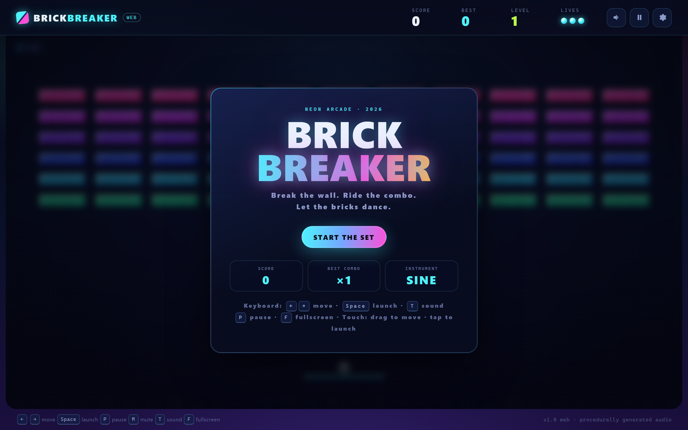
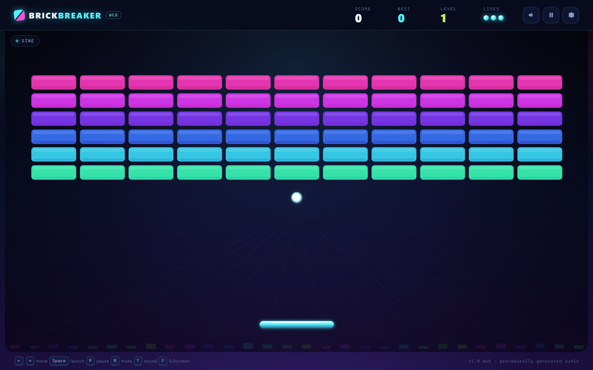
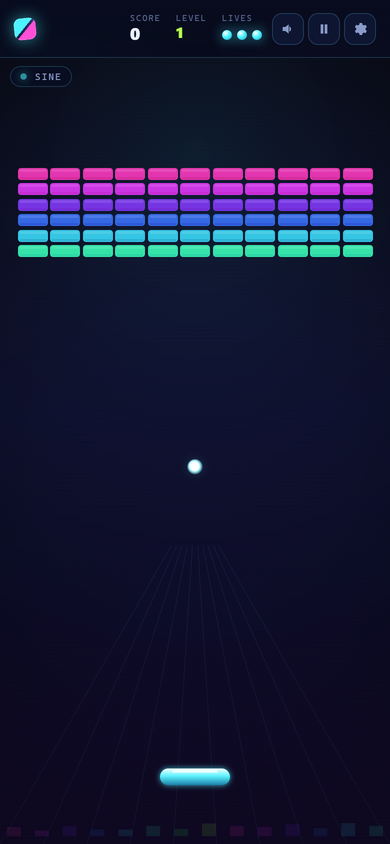
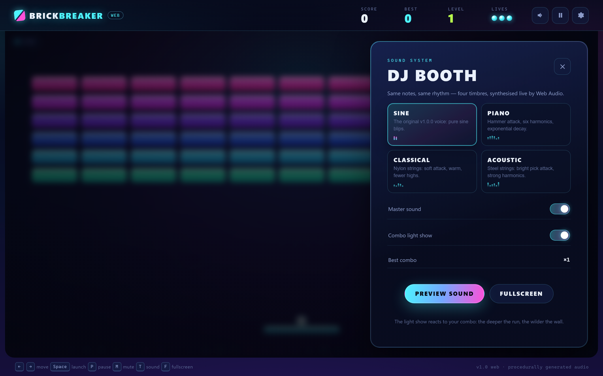

# Brick Breaker — Neon Arcade (Web Edition)

A browser rebuild of the single-file Pygame brick breaker: same physics, scoring
and level design, a brand-new **neon club** visual system, **four live-synthesised
instrument timbres**, a **DJ-style combo light show**, touch controls and
persistent records — with **zero dependencies and no build step**.





<p>
  
  
</p>

## Why a web edition?

The desktop build (repository root) packages Python + Pygame into a Windows exe.
That is fine for offline play, but distribution, antivirus warnings and OS-specific
packaging are a lot of work for a small arcade game. This folder is the same game
as a static website: **open it, share a URL, phone or laptop — done.**

## Quick start

### Play locally (no install, no build)

1. Open `web/index.html` in a modern browser (double-click works: the app is made
   of classic `<script>` files, not ES modules).
2. Press **Space** (or tap) to start.

> Audio needs a user gesture (browser autoplay policy); the first click/keypress
> unlocks the Web Audio context. The game is fully playable while muted.

For reliable `localStorage` persistence during local development, serve the
folder instead of using `file://`:

```bash
# any of these work; the app is 100% static
npx serve .
python -m http.server 8080
```

Then open <http://localhost:8080>.

### Deploy to GitHub Pages

This folder is self-contained. Two options:

- **Inside this repository:** pushing to `main` runs
  [`../.github/workflows/web-pages.yml`](../.github/workflows/web-pages.yml),
  which publishes `web/` to GitHub Pages. Enable Pages → Source: **GitHub
  Actions** once in the repository settings.
- **As its own repository:** copy the contents of `web/` to the repository
  root and push. The included
  [`/.github/workflows/pages.yml`](.github/workflows/pages.yml) deploys it.

No secrets, no build step, no server-side code.

## Controls

| Input | Action |
| --- | --- |
| `←` / `→` or `A` / `D` | Move the paddle |
| `Space` / `↑` / `Enter` | Launch the ball |
| `P` | Pause / resume |
| `R` | Restart the run |
| `M` | Mute / unmute |
| `T` | Cycle instrument: SINE → PIANO → CLASSICAL → ACOUSTIC |
| `F` | Toggle fullscreen |
| Mouse / touch drag | Move the paddle (direct aim, keeps the english bounce) |
| Tap on the playfield | Launch the ball |

## Sound

All audio is synthesised live with the **Web Audio API** — the folder ships no
audio files. The note table is the same "score" as the desktop build; only the
timbre preset changes:

| Preset | Character |
| --- | --- |
| `SINE` | the original v1.0.0 voice |
| `PIANO` | hammer attack, six harmonics, exponential decay |
| `CLASSICAL` | nylon-string guitar: soft attack, warm, fewer highs |
| `ACOUSTIC` | steel-string guitar: bright pick attack, strong harmonics |

Brick hits are pitched by row, so a long rally becomes a melody. Open the
**DJ booth** (gear icon / `S`) to audition timbres, mute, or toggle the light show.

## DJ-style combo light show

The visual signature of the web build. Each destroyed brick triggers a hit
pulse; as the combo multiplier climbs:

- the whole brick wall shifts hue together, with a ripple travelling across the
  columns;
- the bricks glow and brighten on every hit;
- at high multipliers a slow rainbow sweep and a pulsing equalizer floor join in;
- score popups, shards and wave rings are driven by the same beat.

The light show is render-only: it reads the session and never touches the game
model. Toggle it in the DJ booth; `prefers-reduced-motion` is respected.

## Performance & quality

The game loop simulates at a fixed 120 Hz and renders every animation frame. The
renderer is tuned so this stays smooth even on high-DPI laptops:

- the static scenery (gradient, perspective grid, scanlines, vignette) is cached
  in an offscreen canvas and blitted once per frame;
- bricks are **deliberately low-fi pixel sprites**: each one is a 20×8 pixel tile
  (outline, chunky bevel, dither marks, crack pixels) stretched with
  nearest-neighbour filtering. That is faster than drawing rounded paths and
  gradients per brick, and gives the wall an arcade-CRT feel instead of a glossy
  web look;
- the combo glow is a cached sprite, and the equalizer bars are plain rects;
- the canvas backing store is sized from `devicePixelRatio`, and **adaptive
  resolution** lowers that scale when the frame rate drops (it raises it again
  when the machine can keep up). The simulation is never slowed down.
- CSS performance: no `backdrop-filter` on the HUD/chips over the animated
  canvas, and the ambient background is static.

With the pixel bricks, the adaptive renderer reaches ~60 fps at
1440×900@DPR2 in software-rendered headless Chrome (full 2× backing ~34 fps
there; a real GPU is faster), and 60 fps at DPR1 and on phones.

If you want to inspect or control it:

| What | How |
| --- | --- |
| Live FPS / quality / backing size | open `index.html?stats=1` |
| Force crispest rendering | **DJ booth → 画质 / Quality → CRISP**, or `?quality=high` |
| Force fastest rendering | **DJ booth → Quality → FAST**, or `?quality=low` |
| Back to adaptive | **DJ booth → Quality → AUTO** (default) |

`?quality=high|low` is a temporary override for testing; the DJ-booth choice is
remembered in `localStorage`.

## Troubleshooting

- **Occasional whole-screen flash/blink:** normally the adaptive quality engine
  changing the canvas backing resolution. It now changes at most once per ~3 s,
  needs two bad FPS windows to step down, probes a higher scale at most once and
  rolls back without retrying, and redraws immediately after the resize — so it
  should settle after the first few seconds. Forcing **CRISP** or **FAST** in the
  DJ booth keeps the scale fixed. If it still happens, check that browser
  hardware acceleration is enabled.
- **Bright pulsing during big combos:** that is the combo light show, not a
  rendering bug. Turn it off in the DJ booth (or respect reduced motion).
- **One flash when entering/leaving fullscreen or resizing the window:** the
  browser is changing the viewport/CSS size; the canvas re-renders immediately
  after that resize.

## Persistence

`localStorage` (key `brick-breaker.web.v1`) stores best score, best combo, best
level, the selected instrument, mute state, the light-show preference and the
quality mode. Keep in mind that some browsers isolate `file://` storage; serve
the folder (see above) if you want records to survive reliably.

## Project layout

```text
web/
├── index.html                 # DOM shell: HUD, overlays, HUD chips
├── css/style.css              # neon visual system, responsive layout
├── js/
│   ├── 00-config.js           # M1 CONFIG + enums + palette
│   ├── 10-model.js            # M2 GEOMETRY + M3 MODEL
│   ├── 20-rules.js            # M5 RULES (pure scoring/speed policy)
│   ├── 21-levels.js           # M6 LEVELS (brick wall factory)
│   ├── 22-physics.js          # M4 PHYSICS (sub-stepped collisions)
│   ├── 30-audio.js            # M7 AUDIO (Web Audio engine + note/preset data)
│   ├── 40-storage.js          # localStorage persistence (web-only)
│   ├── 50-renderer.js         # M8 VIEW (canvas renderer + combo light show)
│   ├── 60-session.js          # M10 SESSION (run state machine)
│   ├── 70-input.js            # M9 INPUT (keyboard + pointer/touch → Intent)
│   └── 80-app.js              # M11 APP (loop, DOM shell, overlays, demo hooks)
├── assets/icon.svg            # favicon / logo
├── docs/screenshots/          # README screenshots
├── tests/
│   ├── core.test.mjs          # 35 Node tests for the simulation core
│   ├── helpers/load-core.mjs  # loads the classic scripts in a Node vm
│   └── browser-check.mjs      # dev-only headless Chrome / CDP verifier
├── .github/workflows/pages.yml# self-contained Pages workflow
├── LICENSE
└── README.md / README.zh-CN.md / ARCHITECTURE.md
```

Script load order in `index.html` **is** the dependency graph; every module
attaches itself to the shared `BB` namespace. See
[`ARCHITECTURE.md`](ARCHITECTURE.md) for the full module map, data flow and
design rules.

## Tests

No npm dependencies. The simulation core runs in plain Node (Node 18+; the
bundled Node 24 was used here):

```bash
node tests/core.test.mjs
# or: node --test --test-isolation=none tests/core.test.mjs
```

35 tests cover geometry, brick state machine, scoring, level factory, physics
(walls/paddle/brick/floor), session lifecycle, resize, pointer aiming, and the
audio-intent path.

Optional browser verification (needs Chrome/Edge; dev only):

```bash
node tests/browser-check.mjs \
  --url "file:///absolute/path/to/web/index.html?demo=combo5" \
  --width 1440 --height 900 --dpr 2 \
  --key "Space,KeyT" --screenshot out.png
```

It reports layout metrics (including `devicePixelRatio`, canvas backing size and
overflow), console errors, post-input state, and can drive touch/mouse drags.
`?demo=title|playing|combo5|gameover|paused|settings` loads deterministic
fixtures for screenshots.

## Design notes

- **HiDPI:** the canvas backing store is `CSS size × devicePixelRatio`
  (clamped and adapted for performance); all game logic runs in CSS pixels. DOM
  HUD text therefore stays crisp at any zoom or Retina display.
- **Adaptive performance:** if a device cannot sustain ~55 fps, the renderer
  lowers only the canvas resolution (never the physics rate) and recovers it when
  there is headroom. `?stats=1` shows the live numbers; the DJ booth can force
  CRISP or FAST.
- **Responsive:** the playfield is derived from the live canvas size; the layout
  switches to compact HUD + touch hints on phones (portrait and landscape).
- **Accessibility:** semantic buttons with ARIA, focus-visible styles,
  `prefers-reduced-motion` support, keyboard-only play.
- **Privacy:** no network requests, no analytics, no accounts — everything runs
  locally in the browser.

## License

MIT — see [`LICENSE`](LICENSE). The desktop Pygame build lives at the
repository root and keeps its own build/test tooling.
