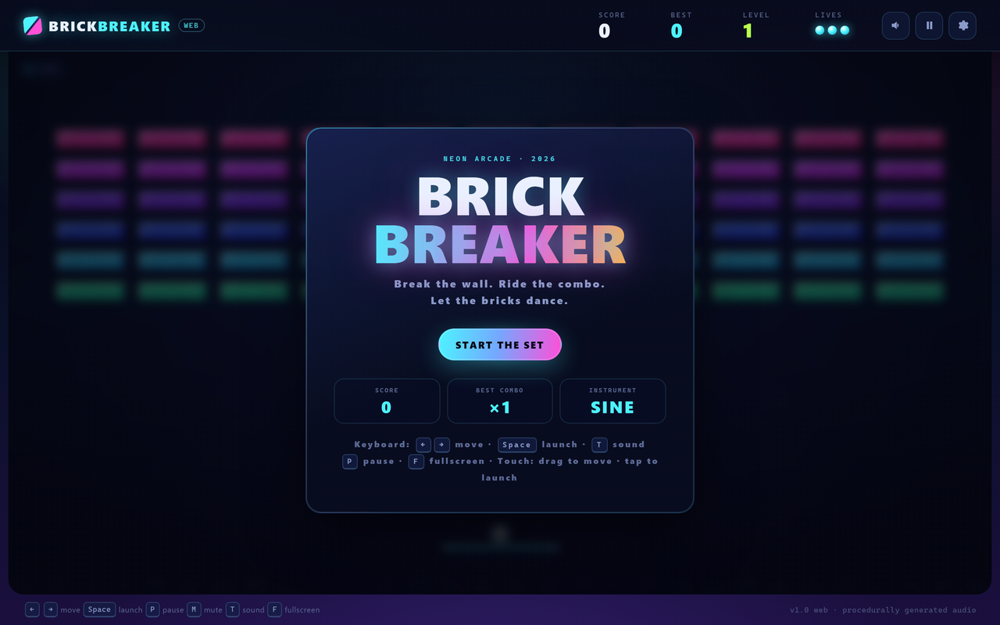
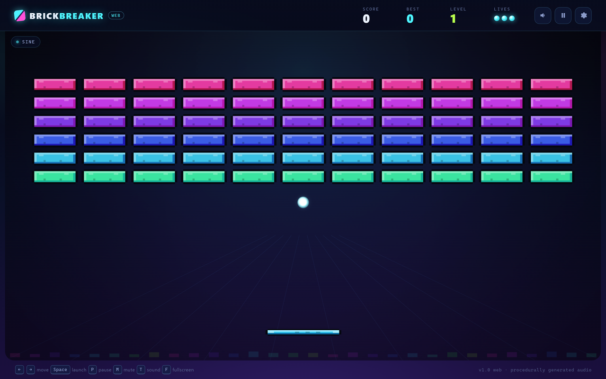

# Brick Breaker · 霓虹街机版（网页版）

用纯网页重制的打砖块：物理、计分与关卡设计与单文件 Pygame 桌面版一致，
但换了一套「霓虹夜店」视觉；四种实时合成的乐器音色；连击时砖墙会像 DJ 一样
整体变色、随节拍呼吸；支持触控与本地持久化。**零依赖、无需构建**。





连击灯光秀见 [combo-lightshow.png](docs/screenshots/combo-lightshow.png)，
手机竖屏见 [gameplay-mobile.png](docs/screenshots/gameplay-mobile.png)。

## 为什么做网页版

桌面版把 Python + Pygame 打包进 Windows exe，适合离线玩；但分发、杀毒误报、
安装器兼容性对一个小游戏来说成本太高。网页版就是同一个游戏的静态网站：
**打开即玩、发个链接就能分享，手机电脑都行。**

## 快速开始

### 本地直接玩（无需安装/构建）

1. 用现代浏览器打开 `web/index.html`（直接双击也可以：全部是经典 `<script>`，
   不依赖 ES modules 或本地服务器）。
2. 按 **空格**（或点一下画面）开始。

> 浏览器要求先有一次用户手势才能出声（autoplay 策略）：第一次按键/点击会解锁
> Web Audio。静音状态下游戏也能正常玩。

如果希望 `localStorage` 持久化在本地开发时也稳定生效，建议用静态服务器打开：

```bash
npx serve .
python -m http.server 8080
```

然后访问 <http://localhost:8080>。

### 部署到 GitHub Pages

本目录是自包含的，两种方式：

- **放在当前仓库里**：推送到 `main` 会触发根目录的
  [`../.github/workflows/web-pages.yml`](../.github/workflows/web-pages.yml)，
  把 `web/` 发布到 GitHub Pages（在仓库 Settings → Pages → Source 选择
  **GitHub Actions** 一次即可）。
- **单独建仓库**：把 `web/` 里的内容复制到仓库根目录再推送；自带的
  [`/.github/workflows/pages.yml`](.github/workflows/pages.yml) 会负责发布。

不需要密钥、不需要构建步骤、没有服务端代码。

## 操作

| 输入 | 动作 |
| --- | --- |
| `←` / `→` 或 `A` / `D` | 移动挡板 |
| `Space` / `↑` / `Enter` | 发射 |
| `P` | 暂停 / 继续 |
| `R` | 重开 |
| `M` | 静音 / 取消静音 |
| `T` | 切换音色：SINE → 钢琴 → 古典吉他 → 民谣吉他 |
| `F` | 全屏 |
| 鼠标拖动 / 触屏拖动 | 直接控制挡板（保留挡板速度带来的旋转） |
| 点击/轻触场地 | 发射 |

## 音效

全部由 **Web Audio API** 实时合成，不包含任何音频文件。音符表与桌面版一致，
只切换音色：`SINE`（原版）、`PIANO`（钢琴）、`CLASSICAL`（古典/尼龙弦）、
`ACOUSTIC`（民谣/钢弦）。砖块按行发音，连续对打会变成旋律。

点右上角齿轮（或按 `S`）打开 **DJ BOOTH**：试听音色、静音、开关灯光秀。

## 连击灯光秀

网页版的核心视觉特色。每击碎一块砖触发一次打击脉冲；随着连击倍率升高：

- 整面砖墙一起偏移色相，并有一道波纹沿列扫过；
- 砖块随每次击打发光、提亮；
- 高倍率时出现缓慢的彩虹扫色 + 底部脉冲均衡器；
- 飘分、碎屑、冲击波都由同一节拍驱动。

灯光秀是纯渲染效果：只读 session，不修改游戏模型。可在 DJ BOOTH 中关闭，
并尊重系统 `prefers-reduced-motion` 设置。

## 性能与画质

游戏逻辑固定 120 Hz，渲染跟随每一帧动画。为了在高分屏/弱显卡上也顺滑：

- 静态背景（渐变、透视网格、扫描线、暗角）预先画到离屏 canvas，每帧只 blit 一次；
- 砖块改成**刻意低清的像素 sprite**：每块砖是 20×8 的像素图（描边、粗高光、抖动点、裂纹像素），
  用最近邻放大。既比每块砖画圆角路径/渐变便宜，又有街机 CRT 的粗糙感，不再是“过于精致的网页风”；
- 挡板也换成同一套像素语言（36×5 sprite，描边/粗高光/防滑纹），并跟随连击热度变色，
  你控制的板子终于和砖墙是一个画风；
- 连击光晕用缓存 sprite，底部均衡器改用纯矩形；
- canvas backing store 按 `devicePixelRatio` 设置，并带**自适应分辨率**：帧率掉下来时只降画质、不降物理频率，机器有余量时再升回去；
- CSS 也做了减负：HUD/芯片不再对动画 canvas 做 `backdrop-filter`，环境背景改为静态。

换成像素砖块后，headless Chrome 软件渲染下 1440×900@DPR2 自适应约 **60 FPS**
（强制全 2x backing 在这个软件渲染环境约 34 FPS，真实 GPU 会更高），DPR1 和手机都是 60 FPS。

想检查或手动控制：

| 想做什么 | 怎么做 |
| --- | --- |
| 看实时 FPS / 画质 / 分辨率 | 打开 `index.html?stats=1` |
| 强制最清晰 | **DJ BOOTH → 画质 / Quality → CRISP**，或 `?quality=high` |
| 强制最流畅 | **DJ BOOTH → Quality → FAST**，或 `?quality=low` |
| 恢复自动 | **DJ BOOTH → Quality → AUTO**（默认） |

`?quality=high|low` 仅用于临时测试；DJ BOOTH 里的选择会记住。

## 常见问题

- **偶尔整屏闪一下：** 通常是自适应画质在切换 canvas backing 分辨率。现在最多约 3 秒
  才允许变一次、需要连续两个低帧窗口才降档、向上试探只做一次且失败不重试，并在 resize
  后立刻重绘，正常情况下开头几秒稳定后就不该再闪。在 DJ BOOTH 里固定 **CRISP** 或
  **FAST** 就不会再变分辨率。如果仍然闪，检查浏览器是否开了硬件加速。
- **高连击时画面亮暗脉冲：** 那是连击灯光秀本身的效果，可在 DJ BOOTH 关掉。
- **进入/退出全屏或拖窗口时闪一下：** 浏览器在改变视口尺寸，canvas 会立刻重绘，属于正常现象。

## 持久化

`localStorage`（键名 `brick-breaker.web.v1`）会保存：最高分、最高连击、最高关卡、
当前音色、静音状态、灯光秀开关和画质模式。注意部分浏览器会隔离 `file://` 的存储；
需要可靠持久化时用上面的静态服务器方式打开。

## 目录结构

见 [README.md](README.md) 的 Project layout（结构相同），或直接看
[`ARCHITECTURE.md`](ARCHITECTURE.md) —— 里面有 M1–M11 与桌面版的模块映射、
依赖顺序、数据流、音频/灯光/持久化设计。

## 测试

无需 npm 依赖，Node 18+ 即可：

```bash
node tests/core.test.mjs
```

35 个测试覆盖几何、砖块状态机、计分、关卡、物理（墙/挡板/砖块/地板）、
会话生命周期、resize、指针瞄准和音色切换的 Intent 链路。

可选浏览器验收（需要 Chrome/Edge，仅开发用）：

```bash
node tests/browser-check.mjs \
  --url "file:///绝对路径/web/index.html?demo=combo5" \
  --width 1440 --height 900 --dpr 2 \
  --key "Space,KeyT" --screenshot out.png
```

会输出布局指标（含 DPR、canvas backing size、是否溢出）、控制台错误、输入后的
状态，并可模拟鼠标/触控拖动。`?demo=title|playing|combo5|gameover|paused|settings`
提供确定性截图用状态。

## 设计说明

- **高分屏**：canvas backing store = CSS 尺寸 × devicePixelRatio（按性能自适应），
  游戏逻辑仍用 CSS 像素，DOM HUD 文字在任何 DPI 下都清晰。
- **自适应性能**：设备维持不了约 55 FPS 时只降低 canvas 分辨率（绝不降低物理频率），
  有余量时自动升回；`?stats=1` 可看实时数值，DJ BOOTH 里可强制 CRISP / FAST。
- **响应式**：场地尺寸由实时 canvas 尺寸推导；手机竖屏/横屏自动切换紧凑 HUD 与触控提示。
- **可访问性**：语义化按钮 + ARIA、可见焦点、`prefers-reduced-motion`、全键盘可玩。
- **隐私**：无网络请求、无统计、无账号，全部在浏览器本地运行。

## 许可证

MIT，见 [`LICENSE`](LICENSE)。桌面版（仓库根目录）保留其原有构建与测试工具。
